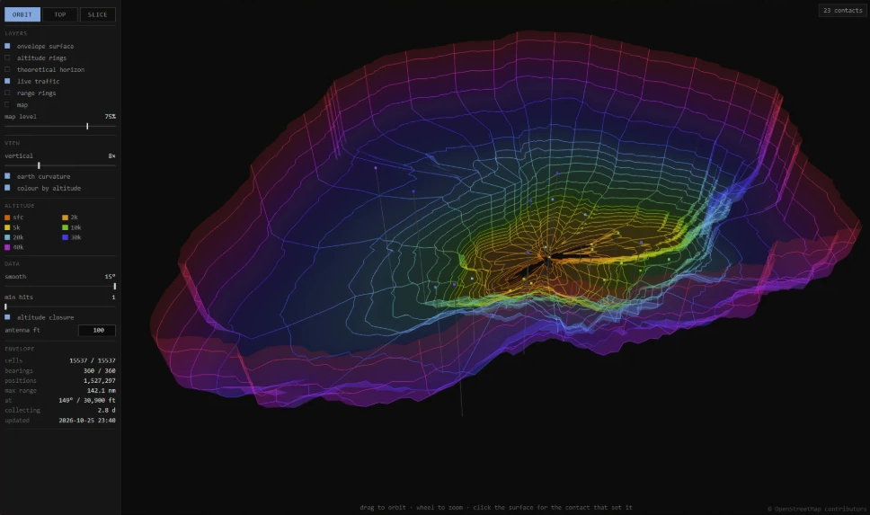

# ADS-B-3D-Antenna-Range-Visualizer

A visualizer to view the true range of your ADS-B antenna at different altitudes in 3D space. A single-button add-on to your current readsb/tar1090 setup.



## Why

tar1090's blue outline shows your farthest range, but not the altitude a plane had to be at for you to hear it. I live in an area surrounded by mountains with a DIY spider antenna, so my range at 10 nautical miles looks nothing like my range at 100.

This shows coverage as a volume rather than a polygon, so you can actually see that difference.

## Features

- One button in tar1090 opens the 3D viewer
- Maximum range per 1° bearing across 49 altitude bands, surface to 50,000 ft
- Live aircraft rendered inside the envelope
- The same OpenStreetMap and altitude colours tar1090 already uses
- Click the surface to see the aircraft that set that record
- Saved view settings

## Modes

**Orbit**: the envelope as a surface you can spin.

**Top**: straight down.

**Slice** — a vertical cross-section.

## Requirements

- readsb or dump1090 with tar1090, and a configured receiver position
- systemd, lighttpd and python3, or Docker (see [Docker](#docker))
- An internet connection once, to download map tiles

## Install

```bash
git clone https://github.com/Charan-N15/ADS-B-3D-Antenna-Range-Visualizer.git
cd ADS-B-3D-Antenna-Range-Visualizer
sudo ./install.sh
```

It reads your receiver position from tar1090, installs a collector service, downloads map tiles for your area, installs the viewer, and adds a `3D` button to your tar1090 page.

Then open `http://your-pi/range3d/`.

The envelope starts empty, and your antenna range will carve itself out over a few days, once you receive enough data from aircraft.

## Docker

If your tar1090 runs in a container, such as the [sdr-enthusiasts ultrafeeder](https://github.com/sdr-enthusiasts/docker-adsb-ultrafeeder) stack, use this instead of `install.sh`. One container runs the collector, serves the viewer, and proxies tar1090 so live aircraft and `RETURN TO 2D` work from the same address.

Add it to the `docker-compose.yml` that runs tar1090:

```yaml
services:
  range3d:
    build: ./ADS-B-3D-Antenna-Range-Visualizer
    restart: unless-stopped
    ports:
      - 8099:8080
    environment:
      - TAR1090_URL=http://ultrafeeder
      - RANGE3D_ANTENNA_FT=120
    volumes:
      - ./range3d:/data
```

```bash
docker compose up -d --build range3d
```

Then open `http://your-docker-host:8099/`. It seeds from tar1090's range outline, downloads map tiles in the background, and keeps everything in `/data` across restarts and rebuilds.

Settings are listed at the top of `docker/entrypoint.sh`.

The `3D` button is not added in this mode, because tar1090's files belong to the other container. To move an existing bare-metal install across, copy `/var/lib/range3d/envelope.json` into the data directory before the first start and it will be kept.

## Configuration

For an `install.sh` install, settings live in `/etc/default/range3d`.

## Updating

```bash
git pull
sudo ./install.sh
```

Collected data will not get rewritten if you run `install.sh` again

## Uninstall

```bash
sudo ./uninstall.sh --purge
```

## Credits

Map data © [OpenStreetMap](https://www.openstreetmap.org/copyright) contributors, ODbL. Altitude colours match [tar1090](https://github.com/wiedehopf/tar1090). 3D rendering by [three.js](https://threejs.org/).

## Licence

MIT. See [LICENSE](LICENSE).
