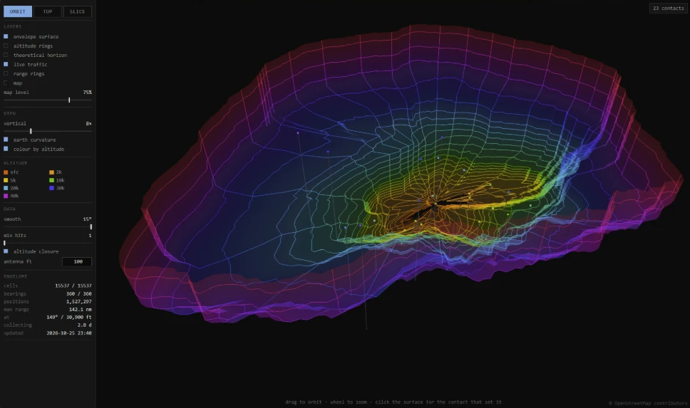

# ADS-B-3D-Antenna-Range-Visualizer

A visualizer to view the true range of your ADS-B antenna at different altitudes in 3D space. A single button add-on to your current readsb/tar1090 setup.



## Why

tar1090 draws a blue outline showing the farthest contact on each bearing. The problem is that it ignores altitude. On a typical receiver the overwhelming majority of those record-holding contacts are airliners at cruise — on the receiver this was built against, 332 of the 360 were above 5,000 ft, with the full range running from 400 ft to 47,025 ft.

So the outline tells you how far you can hear *something*, somewhere, at some altitude. It cannot tell you how far you reach at 3,000 ft, or which bearings are blocked by the hill behind your house.

Coverage is a volume, not a ring. This measures it as one: maximum range for every bearing and every altitude band, accumulated over time, drawn in 3D over a map.

## What it shows

**Orbit** — the coverage envelope as a surface you can spin, with live traffic inside it. Colour follows altitude, using tar1090's own ramp so the two tools agree.

**Top** — looking straight down. Nested contours, one per altitude, over the map. This is the view that shows you where your low-altitude coverage actually ends.

**Slice** — a vertical cross-section along a bearing you pick. It splits the picture into three regions: coverage you have confirmed, coverage that is geometrically possible but you have not achieved, and everything below the horizon that is impossible no matter what antenna you build. The gap in the middle is your headroom.

## Features

- Maximum range per 1° bearing and per altitude band, 49 bands from the surface to 50,000 ft, finest at low altitude where the horizon does the limiting
- Live aircraft rendered in true 3D with drop lines to the ground
- OpenStreetMap tiles on the ground plane, warped into the scope's projection so a range ring crosses the coastline exactly where it really does
- A theoretical 4/3-earth horizon overlay to compare measured coverage against
- Click any point on the surface to see the aircraft that set that record, with its altitude, signal strength and timestamp
- Save your view settings to the browser with one button
- Per-cell hit counts, so a single bad position decode never permanently inflates your range

## Requirements

- A working readsb or dump1090 receiver with tar1090 on top
- A configured receiver position — without `--lat`/`--lon` there is no range to measure
- systemd, lighttpd, and python3 (standard library only, nothing to pip install)
- An internet connection once, to download map tiles

## Install

```bash
git clone https://github.com/Charan-N15/ADS-B-3D-Antenna-Range-Visualizer.git
cd ADS-B-3D-Antenna-Range-Visualizer
sudo ./install.sh
```

That reads your receiver position from tar1090, installs a collector service, downloads map tiles for your area, installs the viewer, and adds a `3D` button to your tar1090 page.

It is additive. Nothing belonging to readsb or tar1090 is reconfigured, and nothing serving live data is restarted. The one file of tar1090's it touches is `html/config.js`, which gets a link appended — and that file survives `tar1090-update`, so the button does too.

Then open `http://your-pi/range3d/`, or click the `3D` button in tar1090.

### Give it time

The envelope starts empty and fills only as aircraft fly through it. There is no historical data to backfill from.

High altitude fills within hours. Low altitude takes days to weeks, because distant low-flying traffic is rare — which is exactly why the altitude breakdown is worth having. If it looks sparse on the first day, it is working correctly.

## Configuration

Settings live in `/etc/default/range3d`. The one worth setting is your antenna's height above sea level:

```
RANGE3D_ANTENNA_FT="--rx-alt-ft 120"
```

That only affects the theoretical horizon overlay; your measured coverage is unaffected by it. Restart after editing:

```bash
sudo systemctl restart range3d-collector
```

Re-running `install.sh` never overwrites this file.

## Updating

```bash
git pull
sudo ./install.sh
```

Your collected data and your settings are both left alone.

## Uninstall

```bash
sudo ./uninstall.sh
```

Your collected envelope is kept — it represents months of observations that cannot be regenerated. Pass `--purge` if you really want it gone.

## How it works

[docs/DESIGN.md](docs/DESIGN.md) covers the data model, why the altitude closure runs upward rather than downward, the quality filters, and the projection.

## Credits

Map data © [OpenStreetMap](https://www.openstreetmap.org/copyright) contributors, ODbL. Altitude colours match [tar1090](https://github.com/wiedehopf/tar1090). 3D rendering by [three.js](https://threejs.org/).

## Licence

MIT. See [LICENSE](LICENSE).
